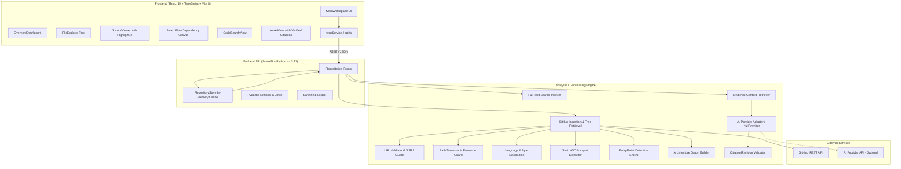

# RepoSense AI — Technical Architecture

This document specifies the technical architecture, component boundaries, data flow pipelines, security defenses, and design decisions for RepoSense AI.

---

## 1. Architectural Principles

1. **Deterministic Static Analysis First:** Understand codebases through factual AST extraction, symbol mapping, and relationship indexing rather than ungrounded probabilistic text generation.
2. **Untrusted Code Sandboxing:** Treat all ingested repository code, files, manifests, and metadata as hostile data. Code is parsed as passive text, never executed.
3. **Decoupled AI Layer:** The core exploration, search, and visualization pipelines operate 100% independently of external AI APIs. AI functions strictly as an interpretive assistant grounded in verified facts.
4. **Defense in Depth:** Multi-layer validation guarding every network request, file lookup, memory allocation, and client-side render.

---

## 2. System Overview & Component Topology



---

## 3. Frontend Architecture

### 3.1 Technology Stack
- **Framework:** React 19 with strict TypeScript.
- **Build Tool:** Vite 8 configured with Rollup vendor chunking (`vendor-react`, `vendor-xyflow`, `vendor-highlight`, `vendor-icons`).
- **Styling:** Tailwind CSS v4 using a unified dark-mode design system with responsive layouts and accessible focus states.
- **Graph Visualization:** `@xyflow/react` (React Flow) with interactive nodes, dependency arrows, zoom, pan, and details drawer.
- **Syntax Highlighting:** Highlight.js with dark-mode theme and safe text rendering (no `innerHTML` execution).
- **Icons:** Lucide React.
- **Test Framework:** Vitest + Testing Library (10 test suites, 33 tests).
- **Linter:** Oxlint (0 warnings across all files).

### 3.2 Component Hierarchy
```
App.tsx
├── StatusBadge (Backend health & latency monitor)
└── LandingPage (Repository input, sample presets, system specs)
     └── MainWorkspace (Loaded repository workspace)
          ├── Navigation Tabs Bar (Overview, Explorer, Graph, Search, Ask AI)
          ├── OverviewDashboard (Metadata, language percentages, entry points)
          ├── FileExplorer (Nested directory tree with search filter)
          ├── SourceViewer (Line-numbered code display with copy & GitHub links)
          ├── ArchitectureGraphView (Interactive React Flow module diagram)
          ├── CodeSearchView (Full-text search with context snippets & line jumping)
          └── AskAIView (Grounded Q&A with validated citations)
```

---

## 4. Backend Architecture

### 4.1 Technology Stack
- **Framework:** FastAPI with Uvicorn ASGI server.
- **Configuration:** Pydantic v2 Settings reading `.env` with fallback to safe local defaults.
- **HTTP Client:** HTTPX with connection pooling, timeouts, and custom headers.
- **Static Analysis:**
  - Python `ast.parse` for syntax trees and module import extraction.
  - Regex tokenizers for JavaScript, TypeScript, Java, C/C++, Go, and Rust.
  - Manifest parsers: `package.json`, `requirements.txt`, `pyproject.toml`.
- **Testing:** Pytest with AnyIO (49 automated tests).

### 4.2 Module Layout
```
backend/
├── app/
│   ├── api/
│   │   ├── router.py                  # API v1 aggregator
│   │   └── v1/
│   │       └── endpoints/
│   │           ├── health.py          # /health and /api/v1/health
│   │           └── repositories.py    # Analyze, tree, content, search, ask, graph
│   ├── core/
│   │   ├── config.py                  # Pydantic Settings & CORS rules
│   │   └── logging.py                 # Structured logger with SensitiveDataFilter
│   ├── schemas/                       # Pydantic request/response models
│   └── services/
│       ├── github_url.py              # URL syntax & SSRF defense
│       ├── github_ingestion.py        # GitHub API tree retrieval & bounds
│       ├── language_detection.py      # Language mapping & byte distribution
│       ├── entry_point_detection.py   # Heuristic & AST entry point detector
│       ├── static_analysis.py         # Static imports & package dependencies
│       ├── architecture_graph.py      # React Flow node-link graph generator
│       ├── search_engine.py           # In-memory full-text code search
│       ├── repository_store.py        # Thread-safe in-memory cache
│       └── ai/                        # Grounded AI provider abstraction
│           ├── provider_factory.py    # Provider factory (none, gemini, openai, ollama)
│           ├── null_provider.py       # Offline deterministic AI-free mode
│           ├── context_retriever.py   # Bounded evidence retrieval & prompt tagging
│           └── citation_validator.py  # Strict file & line range verification
└── tests/                             # Automated pytest test suites
```

---

## 5. Security & Trust Architecture

### 5.1 SSRF Defense
All repository ingestion requests are validated through `parse_and_validate_github_url`:
- Protocol restricted strictly to `https` (or `http` for local testing).
- Host restricted strictly to `github.com` or `www.github.com`.
- Blocks private IPv4 (`10.0.0.0/8`, `172.16.0.0/12`, `192.168.0.0/16`, `127.0.0.0/8`), IPv6 loopback (`::1`), link-local/cloud metadata (`169.254.169.254`, `metadata.google.internal`), and embedded credentials (`user:pass@`).

### 5.2 Path Traversal & Injection Defense
All paths are inspected via `validate_path_safety`:
- Traversal sequences (`../`, `..\\`) are rejected.
- Windows drive paths (`C:`, `D:`) are rejected.
- URL-encoded traversal sequences (`%2e%2e`, `%2f`, `%5c`) are rejected.
- Null bytes (`\0`) and excessive path lengths (>500 chars) are rejected.
- Endpoint `/files/content?path=...` strictly enforces `validate_path_safety`.

### 5.3 Resource Bounds & DoS Prevention
| Resource | Limit | Behavior on Limit Exceeded |
|---|---|---|
| Tree Entries | 5,000 | Ingestion marks status as `partial`, continues with valid subset |
| Total Source Bytes | 25 MB | Ingestion halts further blob fetching, marks status as `partial` |
| Individual File Size | 1 MB | File content omitted from in-memory cache; file remains in tree |
| Files Processed | 600 | Highest-priority files (manifests, entry points) processed first |
| Request Timeout | 30.0s | Aborts request cleanly and returns HTTP 504 `REQUEST_TIMEOUT` |

### 5.4 AI Prompt Injection & Citation Grounding
- Untrusted code snippets are wrapped in explicit delimiter headers.
- Citations returned by LLMs are validated against actual repository content and line numbers. Citations for non-existent files or invalid line ranges are dropped.
- In AI-free mode (`NullProvider`), answers are assembled purely from verified static analysis facts.
